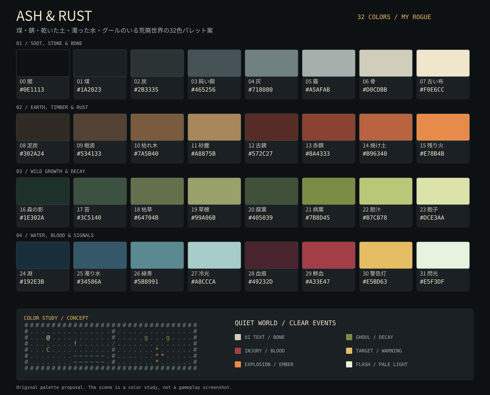

# Ash & Rust 32

煤、錆、乾いた土、濁った水、グールのいる荒廃世界に合わせた32色のパレット案。
地形と素材はくすんだ色でまとめ、文字・選択・攻撃の光には明るい色を割り当てる。



## ファイル

| ファイル | 内容 |
| --- | --- |
| [palette.svg](palette.svg) | 色名・HEX・番号の一覧と、簡易マップの配色サンプル。拡大表示できる |
| [palette.json](palette.json) | 32色の識別名・日本語名・HEX・RGB・用途。RGBは0〜255 |
| [palette.gpl](palette.gpl) | GIMP Palette形式。RGBと識別名を並べたテキスト |

## 色の構成

| 番号 | 系統 | 主な役割 |
| --- | --- | --- |
| 00〜07 | 煤・石・骨 | 背景、金属、壁、文字、包帯 |
| 08〜15 | 土・木材・錆 | 道、倉庫、家具、廃材、火 |
| 16〜23 | 植生・腐敗 | 野原、生垣、グール、毒、病気 |
| 24〜31 | 水・血・信号 | 池、薬瓶、照準、出血、警告、閃光 |

## ゲームへの割り当て案

- 背景は `void`、パネルは `soot`、通常文字は `bone`、補助文字は `fog`、見出しとプレイヤーは `linen`。
- 地面の文字は `olive` / `dust`、壁の輪郭は `ash`、壁の陰は `steel` / `charcoal`。木材は `timber`、錆びた金属は `rust`。
- 水は `slate_blue` / `verdigris`、照準と情報表示は `ice`。
- グールの肌は `infected`。敵の識別には色に加えてgなどの文字・形を使う。草と同色で埋もれる場合は `bile` で強調する。
- 出血は `blood` と状態名、選択と危険は `warning` と枠や記号を併用する。小さな説明文字は暗い赤で描かず、`bone` などを使う。
- 爆発は `warning` → `ember` → `clay`、閃光は `flash` → `ice`。明るい色を短時間の効果に使う。

`void`背景との計算上のコントラスト比は、通常文字の`bone`が11.85:1、補助文字の`fog`が8.41:1。実ゲームの拡大率・フォント・半透過パネルを含む可読性は別途確認する。

LuaのEntity設定へ転記する例（通常文字色と背景色）:

```lua
fg = { 208, 205, 187 }, -- bone / #D0CDBB
bg = { 14, 17, 19 },   -- void / #0E1113
```

現在は配色資料として保存している。簡易マップは配色の検討用で、実ゲームの画面ではない。ゲーム内Entity・UI・演出への割り当てと実GUI確認は次の段階。
